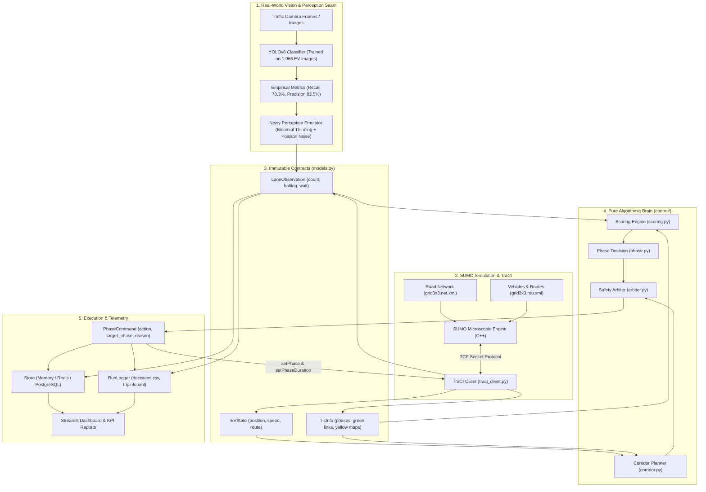
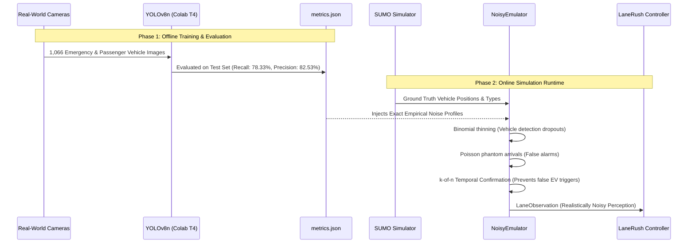
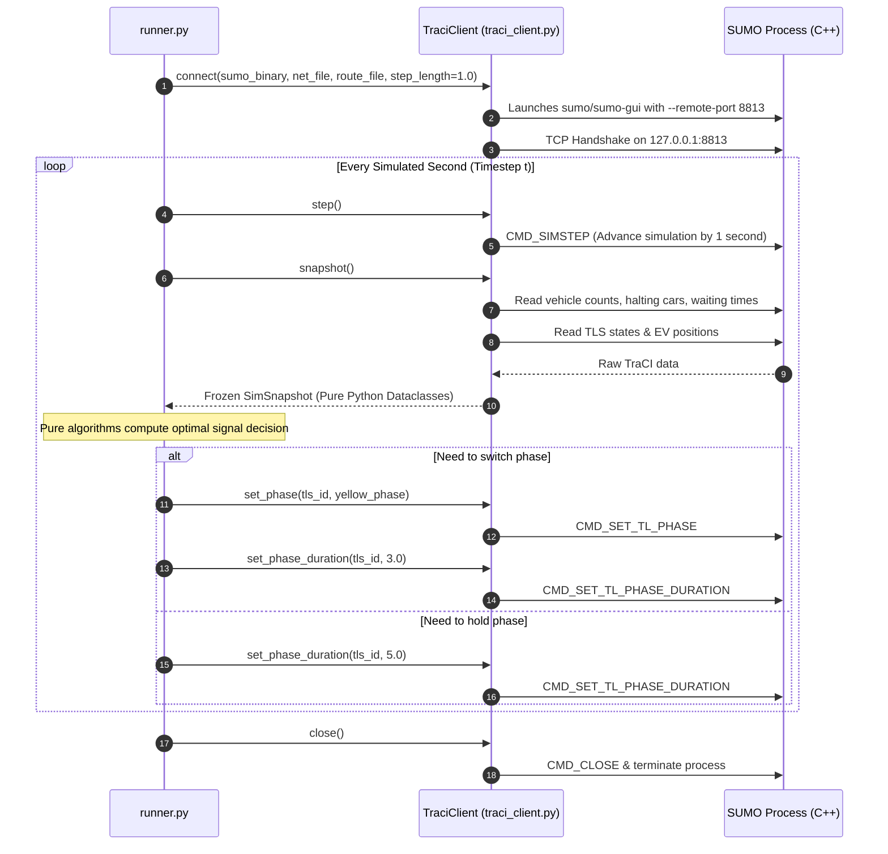
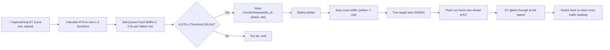

# LaneRush: Technical Architecture & System Explanation

This document provides an end-to-end explanation of how the LaneRush system functions: how real-world perception data bridges to the SUMO simulation environment, the exact role and mechanics of TraCI, how each Python module executes in continuation, and how the algorithmic rulesets govern adaptive traffic rush clearing and emergency vehicle green corridors.

---

## 1. High-Level Architecture Overview

LaneRush operates as a closed-loop cyber-physical system. Each simulated second, the system observes the physical state of the road network, evaluates congestion and emergency priority through mathematical scoring, decides whether to hold or switch signal phases, and executes commands safely through the simulation engine.



---

## 2. Bridging Real-World Image Data to the SUMO Simulator

A central question in simulation-based traffic AI is: *How do we connect machine learning models trained on real camera images with a microscopic traffic simulator like SUMO?*

### The Challenge
- In a production roadside deployment, computer vision models run on CCTV camera feeds overlooking intersection approaches.
- In SUMO, vehicles are simulated mathematically inside a C++ physics engine using car-following models (Krauss, IDM). Feeding raw 60 FPS video into SUMO for thousands of vehicles across 9 intersections simultaneously is computationally prohibitive and divorces the control logic from reproducible evaluation.

### Our Solution: The Two-Tier Perception Seam
LaneRush solves this through an empirical perception interface:



1. **Real-World Training Split (`ml/`):**
   - We trained a lightweight `YOLOv8n` vision model on a curated dataset of 1,066 real-world vehicle images (ambulances, fire engines, police cars, ordinary traffic).
   - The test set evaluation generated concrete, empirical metrics saved in `ml/results/metrics.json`:
     - **EV Detection Recall:** $78.33\%$ (probability of correctly detecting an emergency vehicle in a frame).
     - **EV False Alarm Rate:** $17.47\%$ (probability of an ordinary car or artifact being misclassified as an EV).
     - **Precision:** $82.53\%$, **mAP@50:** $81.25\%$.

2. **The Perception Seam Protocol (`DetectionProvider` in `perception/base.py`):**
   - The control system never talks directly to camera hardware or raw SUMO objects. It only accepts a dictionary of immutable `LaneObservation` objects:
     ```python
     @dataclass(frozen=True)
     class LaneObservation:
         lane_id: str
         count: int           # Number of vehicles on lane
         halting: int         # Number of vehicles at complete standstill (speed < 0.1 m/s)
         max_wait: float      # Longest consecutive wait time among vehicles on this lane
         emergency: bool      # Whether an active emergency vehicle is present
         source: str          # "ground_truth", "noisy", or "yolo"
     ```

3. **Noisy Perception Emulator (`perception/noisy.py`):**
   - During experiments, `NoisyEmulator` takes the true state from SUMO and perturbs it according to the real YOLO model's empirical error rates:
     - **Vehicle Count Thinning:** $\text{Detected Count} \sim \text{Binomial}(N, \text{recall}=0.90)$.
     - **Ghost Vehicles:** Adds $\text{Poisson}(\lambda=\text{false\_alarm})$ phantom vehicle counts.
     - **EV Classification Noise:** Flips the `emergency` boolean using the measured $78.33\%$ recall and $17.47\%$ false alarm rate.
     - **$k$-of-$n$ Temporal Confirmation:** An emergency vehicle alert is only confirmed if detected in at least $k=2$ out of the last $n=3$ consecutive frames, filtering out transient visual false positives.

---

## 3. The Role and Working of TraCI

### What is TraCI?
**TraCI (Traffic Control Interface)** is Eclipse SUMO’s TCP socket-based client-server protocol. 
- SUMO acts as the server listening on a local port (e.g., 8813).
- TraCI acts as the client, sending binary protocol commands and receiving simulation snapshots every timestep.

### TraCI Lifecycle in LaneRush



### Key TraCI Functions Used:
- `traci.trafficlight.getAllProgramLogics(tls_id)`: Discovers all defined signal phases, states (`GGggrrrr`), and default durations.
- `traci.trafficlight.getControlledLinks(tls_id)`: Maps which lane feeds into which green signal index.
- `traci.lane.getLastStepVehicleNumber(lane_id)`: Measures the instantaneous vehicle volume.
- `traci.lane.getLastStepHaltingNumber(lane_id)`: Measures the queue length (vehicles with speed $< 0.1\text{ m/s}$).
- `traci.vehicle.getWaitingTime(veh_id)`: Measures the current consecutive standing time for aging calculation.
- `traci.trafficlight.setPhase(tls_id, phase_index)`: Changes the active phase in SUMO.
- `traci.trafficlight.setPhaseDuration(tls_id, duration_s)`: Sets the duration for yellow clearance or holds.

### The Architectural Boundary (AGENTS.md §2 Rule 2)
Only `src/lanerush/sim/traci_client.py` is permitted to import `traci`. The rest of the codebase works with `SimSnapshot` and `models.py` dataclasses. This allows the entire control and evaluation stack to be unit-tested in fractions of a second using a fast `FakeSim` double without needing a running SUMO process.

---

## 4. How the Python Scripts Execute in Continuation

The repository is organized as a sequential, layered pipeline where each module has a single responsibility:

```
[1. Scenarios]          scenarios/grid3x3/build_net.sh & make_routes.py
                              │
[2. Configuration]      configs/exp_main.yaml -> src/lanerush/config.py
                              │
[3. Orchestration]      src/lanerush/sim/runner.py (Sim loop)
                              ├──> sim/traci_client.py (SUMO snapshot)
                              ├──> perception/noisy.py (Noise injection)
                              │
[4. Pure Control]       src/lanerush/control/
                              ├──> tls_info.py (Discovers phase mappings)
                              ├──> scoring.py (Calculates rush scores)
                              ├──> phase.py (Min/max green & hysteresis)
                              ├──> corridor.py (Predicts EV ETA & requests)
                              └──> arbiter.py (Enforces safety & overrides)
                              │
[5. Logging & Store]    src/lanerush/store/ (CsvRunLogger, Redis, Postgres)
                              │
[6. Evaluation]         src/lanerush/evaluation/ (kpis.py, stats.py, plots.py)
                              │
[7. Presentation]       starter.py, CLI commands, and dashboard/app.py
```

### Execution Flow Step-by-Step:
1. **Scenario Generation (`make_routes.py`):**
   - Defines vehicle types (passenger vs emergency) with calibrated acceleration and max speed.
   - Generates deterministic background traffic flows across rows and columns using stochastic arrival probabilities (`<flow probability=...>`).
   - Inserts scheduled Emergency Vehicles (`EV0` through `EV4`) along designated multi-junction corridors.
2. **Config Validation (`config.py`):**
   - Pydantic v2 reads YAML settings and validates all bounds ($\text{min\_green} \ge 1$, lookahead $\le 5$, valid providers, valid database URLs).
3. **Simulation Runner (`runner.py`):**
   - Initializes `TraciClient`, connects to SUMO, discovers all junction programs via `tls_info.discover()`, and enters the second-by-second simulation loop.
4. **Perception & Scoring (`scoring.py`):**
   - Evaluates each incoming lane's congestion score and sums them to obtain green phase demand.
5. **Phase Decision & Arbitration (`phase.py` & `arbiter.py`):**
   - Decides whether normal traffic warrants a phase switch.
   - Arbitrates between normal traffic demands and high-priority EV corridor requests.
6. **Execution & State Logging (`run_logger.py`):**
   - Applies the commanded action to SUMO via TraCI.
   - Records every decision into `decisions.csv` and departed vehicles into `trips.csv`.
7. **KPI Analysis (`evaluation/kpis.py`):**
   - When the simulation ends, SUMO's native `tripinfo.xml` is parsed to compute mean wait times, emergency transit times, and Jain's fairness index.

---

## 5. Algorithmic Rulesets: Traffic Rush Control & EV Green Corridor

### 5.1 Traffic Rush-Based Adaptive Control

Traditional traffic lights use fixed timers (e.g., 42s green for North-South, then 42s green for East-West), regardless of whether 20 cars are waiting on one side and zero on the other. 

LaneRush replaces this with dynamic, demand-responsive control governed by three equations:

#### 1. Lane Scoring Formula
For each incoming approach lane $i$:
$$\text{Score}_{\text{lane}}(i) = W_{\text{count}} \cdot \text{count}_i + W_{\text{halt}} \cdot \text{halting}_i + W_{\text{age}} \cdot \text{max\_wait}_i$$
Where:
- $\text{count}_i$: Total moving and stopped vehicles in the lane.
- $\text{halting}_i$: Vehicles at a dead stop ($\text{speed} < 0.1\text{ m/s}$). Weighted heavily ($W_{\text{halt}} = 2.0$) so halted queues trigger releases fast.
- $\text{max\_wait}_i$: Consecutive seconds the longest-waiting vehicle has been stuck. Weighted by $W_{\text{age}} = 0.8$ to guarantee fairness and eliminate lane starvation.

#### 2. Phase Scoring Formula
Each signal phase $p$ turns a specific set of incoming lanes green:
$$\text{Score}_{\text{phase}}(p) = \sum_{i \in \text{lanes}(p)} \text{Score}_{\text{lane}}(i)$$

#### 3. The Decision Truth Table (`control/phase.py`)
At every timestep, the controller compares the current active green phase score ($\text{cur\_score}$) with competing red phase scores ($\text{other\_score}$):

| Condition | Action | Rationale |
|---|---|---|
| Active phase is in yellow transition | `hold` | Yellow clearance invariant; never interrupt yellow |
| Elapsed green time $t_{\text{in}} < \text{min\_green}$ (8s) | `hold` | Prevents rapid flickering and pedestrian hazards |
| Elapsed green time $t_{\text{in}} \ge \text{max\_green}$ (50s) and $\text{other\_score} > 0$ | `switch` | Prevents cross-traffic starvation regardless of queue |
| $\text{other\_score} > 1.2 \cdot \text{cur\_score} + 1.0$ | `switch` | **Hysteresis rule:** only switch if competing rush clearly exceeds current lane demand plus buffer |
| Otherwise | `hold` | Retain current green phase (`stay`) |

---

### 5.2 Emergency Vehicle (EV) Green Corridor Pre-Clearing

When an emergency vehicle (ambulance, fire truck) is en route, every second lost at a red light or stuck behind ordinary cars can cost lives. LaneRush implements an active **Green Corridor Engine**:



#### 1. Dynamic ETA Calculation with Queue Term (`control/corridor.py`)
For an EV approaching junction $j$ along its route:
$$\text{distance} = \text{link\_length} - \text{ev.lane\_position}$$
$$\text{effective\_speed} = \min(v_{\text{speed\_limit}}, v_{\text{EV}})$$
$$\text{ETA} = \frac{\text{distance}}{\text{effective\_speed}}$$

A pre-clearance request is triggered if:
$$\text{ETA} \le \text{ETA\_Threshold}_{\text{base}} + 2.0 \cdot \text{halting\_vehicles\_on\_approach}$$
- **The Queue Backlog Term ($+ 2.0 \cdot \text{halting}$):** If 4 ordinary cars are stuck waiting at a red light in front of the EV, the intersection needs additional time to clear those 4 cars *before* the EV arrives. Adding $2.0\text{ seconds}$ per stopped car expands the lookahead window, ensuring the red light turns green early enough to flush the blockage out of the way.

#### 2. The Safety Arbiter (`control/arbiter.py`)
The Arbiter sits between normal adaptive commands and emergency requests:
1. **Yellow Invariant:** If the junction is already yellow, it holds until yellow completes.
2. **Corridor Switch Override:** If an active request demands a different phase and $t_{\text{in}} \ge 2\text{s}$, it overrides normal min/max green rules and commands an immediate switch to yellow $\to$ green for the EV.
3. **Corridor Hold:** Once the EV's phase is green, it locks the signal in green (`corridor_hold`) until the vehicle passes through the junction.
4. **Multi-EV Conflict Resolution:** If two emergency vehicles approach the same junction from different directions, the vehicle with the earlier ETA wins priority.
5. **Rush Recovery:** Immediately after the EV exits, the arbiter releases control back to adaptive scoring. The cross-traffic lanes that were held at red have accumulated high halting and wait scores, causing the controller to immediately switch and flush out the waiting traffic.

---

## 6. Summary of Key Files

| File | Purpose |
|---|---|
| [starter.py](file:///c:/Users/RAGHAV%20KARNATAK/Desktop/laneRush/starter.py) | Standalone 1-click execution script with automatic prerequisite checks and KPI summary. |
| [src/lanerush/models.py](file:///c:/Users/RAGHAV%20KARNATAK/Desktop/laneRush/src/lanerush/models.py) | Authoritative frozen dataclasses (`LaneObservation`, `EVState`, `PhaseCommand`, etc.). |
| [src/lanerush/sim/traci_client.py](file:///c:/Users/RAGHAV%20KARNATAK/Desktop/laneRush/src/lanerush/sim/traci_client.py) | Sole module interacting with SUMO via TraCI; enforces the simulation boundary. |
| [src/lanerush/control/scoring.py](file:///c:/Users/RAGHAV%20KARNATAK/Desktop/laneRush/src/lanerush/control/scoring.py) | Pure mathematical calculation of lane and phase congestion scores. |
| [src/lanerush/control/phase.py](file:///c:/Users/RAGHAV%20KARNATAK/Desktop/laneRush/src/lanerush/control/phase.py) | Adaptive hysteresis decision engine and min/max green safety logic. |
| [src/lanerush/control/corridor.py](file:///c:/Users/RAGHAV%20KARNATAK/Desktop/laneRush/src/lanerush/control/corridor.py) | Emergency vehicle ETA calculation and green corridor pre-clearance planner. |
| [src/lanerush/control/arbiter.py](file:///c:/Users/RAGHAV%20KARNATAK/Desktop/laneRush/src/lanerush/control/arbiter.py) | Safety arbiter balancing emergency green waves with normal traffic flow. |
| [src/lanerush/perception/noisy.py](file:///c:/Users/RAGHAV%20KARNATAK/Desktop/laneRush/src/lanerush/perception/noisy.py) | Couples empirical YOLO model error rates (recall, false alarms) into the simulator. |
| [scenarios/grid3x3/make_routes.py](file:///c:/Users/RAGHAV%20KARNATAK/Desktop/laneRush/scenarios/grid3x3/make_routes.py) | Calibrates stochastic traffic demand and programs the 4-car stuck queue EV release sequence. |
| [configs/exp_main.yaml](file:///c:/Users/RAGHAV%20KARNATAK/Desktop/laneRush/configs/exp_main.yaml) | Primary configuration specifying scoring weights, corridor lookahead, and timings. |
